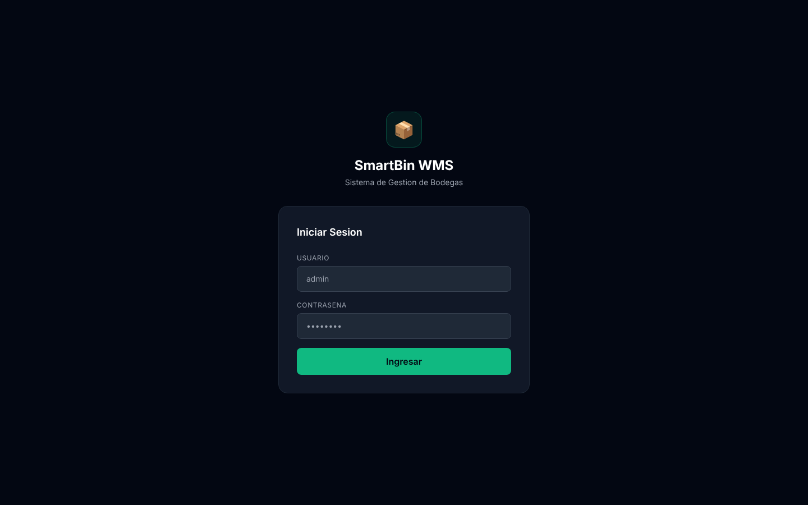
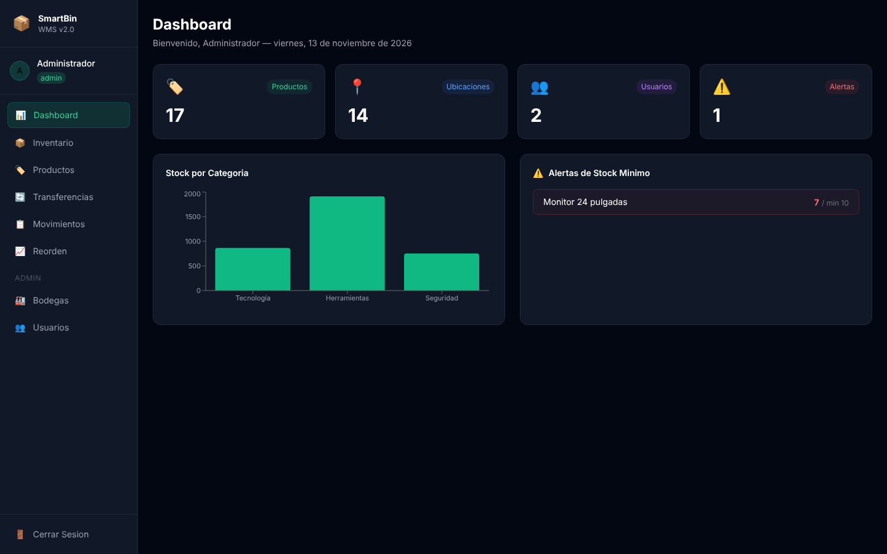
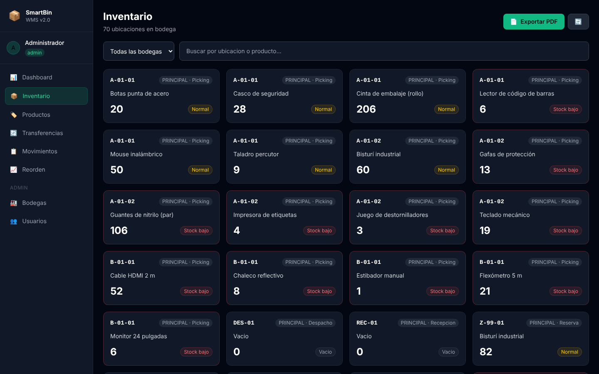
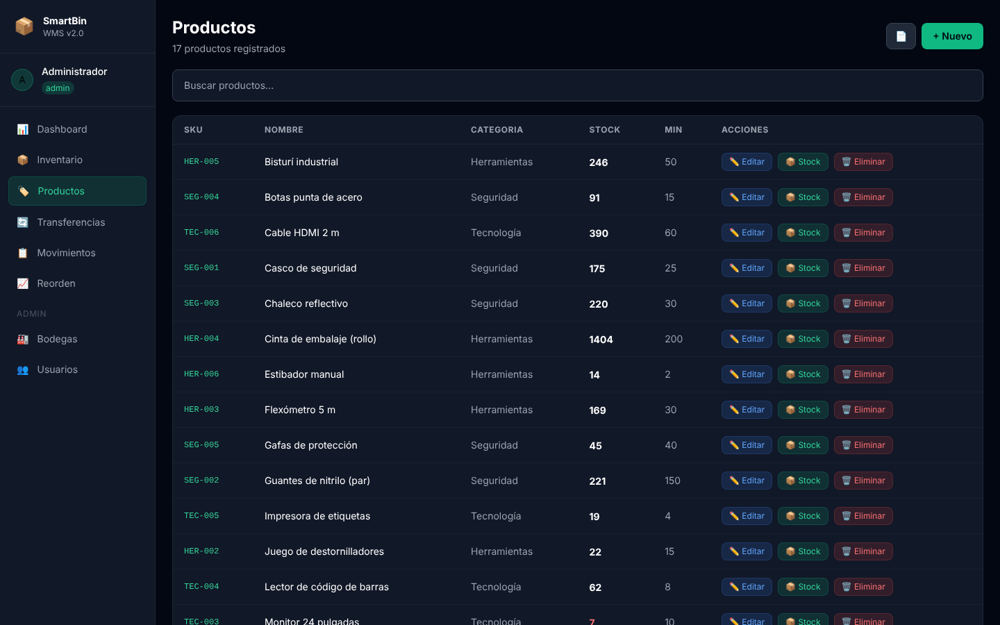
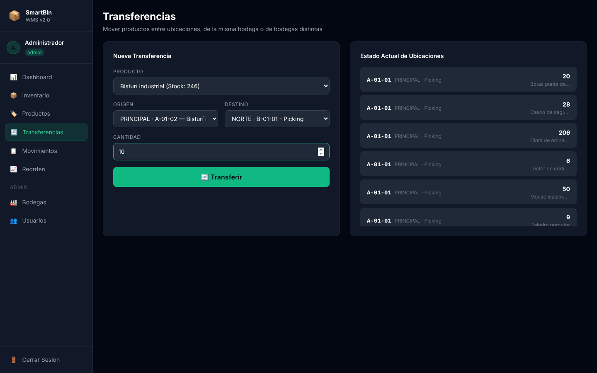
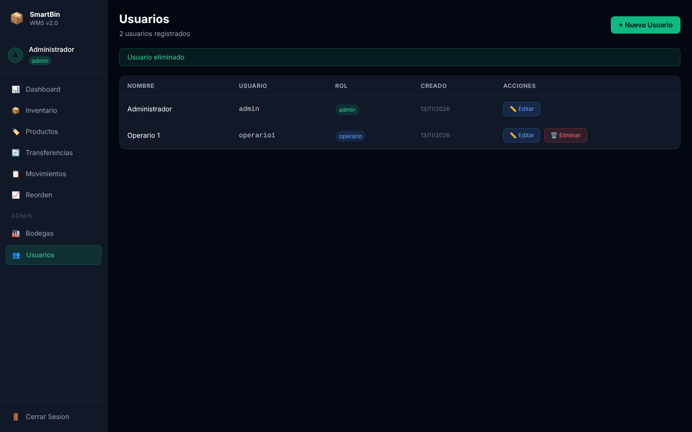
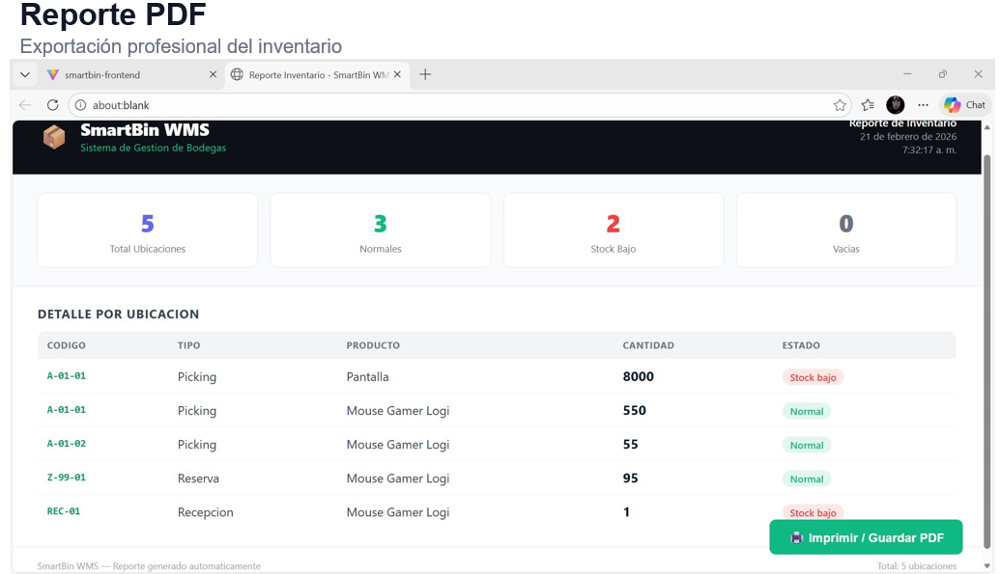

# 📦 SmartBin WMS
> Sistema de Gestión de Bodegas (Warehouse Management System)

Aplicación web completa para gestionar inventario, productos, ubicaciones y usuarios en **una o varias bodegas**, con historial de movimientos y cálculo de puntos de reorden. Desarrollada con **FastAPI** en el backend y **React** en el frontend, con autenticación JWT y roles de usuario.

---

## 🖼️ Capturas del Sistema

### Login


### Dashboard


### Inventario


### Productos


### Transferencias


### Usuarios


### Reporte PDF


---

## ✅ Funcionalidades

- 🔐 **Autenticación JWT** con roles (admin / operario)
- 📊 **Dashboard** con gráficas de stock por categoría y alertas en tiempo real
- 📦 **Inventario** — tarjetas por ubicación con estados (Normal / Stock bajo / Vacío)
- 🏷️ **Productos** — crear, editar y ajustar stock desde el panel
- 🔄 **Transferencias** — mover productos entre ubicaciones de bodega, seguras ante peticiones simultáneas (descuento atómico en la base de datos)
- 🏭 **Multi-bodega** — varias bodegas, cada una con sus ubicaciones; transferencias dentro de una bodega o entre bodegas
- 📋 **Movimientos** — entradas, salidas e historial de cada cambio de stock (quién, cuándo, cuánto y saldo resultante)
- 📈 **Reorden** — punto de reorden y cantidad sugerida por bodega y producto, según las salidas históricas
- 👥 **Usuarios** — gestión de usuarios con roles (solo admin)
- 📄 **Reportes en PDF** — exportar inventario y catálogo de productos
- 📱 **Responsive** — funciona en mobile con menú hamburguesa

---

## 🛠️ Stack Tecnológico

| Capa | Tecnología |
|------|-----------|
| Backend | Python 3.13 + FastAPI |
| Base de datos | MySQL 8.0 |
| Autenticación | JWT (PyJWT) + contraseñas con PBKDF2-SHA256 |
| Frontend | React 19 + Vite |
| Estilos | Tailwind CSS |
| HTTP Client | Axios |
| Rutas | React Router DOM |
| Gráficas | Recharts |

---

## 🚀 Instalación Local

### Requisitos previos
- Python 3.10+
- Node.js 18+
- MySQL 8.0

### 1. Clonar el repositorio
```bash
git clone https://github.com/KeLeBrA99/SmartBin-WMS.git
cd SmartBin-WMS
```

### 2. Configurar el backend
```bash
cd SmartBin_WMS
pip install -r requirements.txt
cp .env.example .env        # en Windows: copy .env.example .env
```

`.env` ya trae los valores de la instalación local de demostración (`root` / `1234`). Si tu MySQL usa otro usuario o contraseña, cámbialos ahí.

### 3. Preparar la base de datos e iniciar
```bash
python preparar_bd.py
python -m uvicorn main:app --reload
```

`preparar_bd.py` crea la base si no existe, crea las tablas, carga los datos iniciales y **actualiza una base creada con una versión anterior** sin borrar su contenido. Se puede ejecutar las veces que haga falta. Si tu base ya tiene datos, haz antes una copia (MySQL Workbench → Server → Data Export).

El backend queda disponible en `http://localhost:8000`  
Documentación automática en `http://localhost:8000/docs`

### 4. Iniciar el frontend
```bash
cd smartbin-frontend
npm install
npm run dev
```

Abrir `http://localhost:5173`

Si el backend no está en `http://localhost:8000`, crea `smartbin-frontend/.env` con `VITE_API_URL=<url del backend>`.

### 5. Pruebas (opcional)
Pruebas de integración contra una base de datos real, incluida la de transferencias concurrentes. Usan una base **dedicada** cuyo nombre debe terminar en `_test` (las tablas se borran en cada ejecución):

```bash
cd SmartBin_WMS
pip install -r requirements-dev.txt
mysql -u root -p -e "CREATE DATABASE smartbin_wms_test CHARACTER SET utf8mb4"
DB_NAME=smartbin_wms_test python -m pytest     # PowerShell: $env:DB_NAME="smartbin_wms_test"; python -m pytest
```

---

## 👤 Usuarios por defecto

| Usuario | Contraseña | Rol |
|---------|-----------|-----|
| admin | admin123 | Administrador |
| operario1 | operario123 | Operario |

Los crea `preparar_bd.py` en una base nueva y son solo para demostración: cámbialos antes de usar el sistema con datos reales (o define `ADMIN_PASSWORD` y `OPERARIO_PASSWORD` antes de ejecutar el script).

---

## 📁 Estructura del Proyecto

```
SmartBin-WMS/
├── database/
│   └── schema.sql               # Tablas de la aplicación
├── SmartBin_WMS/                # Backend
│   ├── main.py                  # API FastAPI con todos los endpoints
│   ├── config.py                # Configuración leída de variables de entorno (.env)
│   ├── security.py              # Hash y verificación de contraseñas
│   ├── reorden.py               # Cálculo de puntos de reorden
│   ├── preparar_bd.py           # Crea o actualiza la base de datos (un solo comando)
│   ├── poblar_bd.py             # Datos iniciales
│   ├── .env.example             # Plantilla de configuración
│   ├── requirements.txt
│   ├── tests/test_api.py        # Pruebas de integración y de concurrencia
│   └── multi_bodega/            # Diseño de referencia para la siguiente etapa
│       ├── schema.sql
│       └── stock_service.py
├── smartbin-frontend/           # Frontend
│   └── src/
│       ├── context/
│       │   └── AuthContext.jsx  # Manejo de sesión JWT
│       ├── pages/
│       │   ├── Login.jsx
│       │   ├── Dashboard.jsx
│       │   ├── Inventario.jsx
│       │   ├── Productos.jsx
│       │   ├── Transferencias.jsx
│       │   ├── Movimientos.jsx
│       │   ├── Reorden.jsx
│       │   ├── Bodegas.jsx
│       │   └── Usuarios.jsx
│       ├── components/
│       │   ├── Sidebar.jsx
│       │   ├── Layout.jsx
│       │   └── ProtectedRoute.jsx
│       ├── api.js               # Configuración Axios
│       └── utils.js             # Escape de HTML y mensajes de error
└── screenshots/                 # Capturas del sistema
```

---

## 🔌 API Endpoints

| Método | Ruta | Descripción | Auth |
|--------|------|-------------|------|
| POST | `/login` | Iniciar sesión | No |
| GET | `/dashboard` | Estadísticas generales | Sí |
| GET | `/productos` | Listar productos | Sí |
| POST | `/productos` | Crear producto | Sí |
| PUT | `/productos/{id}` | Editar producto | Admin |
| PATCH | `/productos/{id}/stock` | Ajustar stock | Admin |
| GET | `/bodegas` | Listar bodegas con sus totales | Sí |
| POST | `/bodegas` | Crear bodega | Admin |
| GET | `/ubicaciones` | Ver inventario por ubicación (`?bodega_id=`) | Sí |
| POST | `/ubicaciones` | Crear ubicación en una bodega | Admin |
| POST | `/entradas` | Registrar recepción de mercancía | Sí |
| POST | `/salidas` | Registrar despacho | Sí |
| POST | `/transferencias` | Transferir stock entre ubicaciones o bodegas | Sí |
| GET | `/movimientos` | Historial (`?tipo=&producto_id=&bodega_id=&limite=`) | Sí |
| GET | `/reorden` | Puntos de reorden (`?bodega_id=&dias=`) | Sí |
| GET | `/usuarios` | Listar usuarios | Admin |
| POST | `/usuarios` | Crear usuario | Admin |

---

## 🔒 Seguridad e integridad de datos

- **Sin secretos en el código:** la clave JWT y las credenciales de MySQL se leen de `.env`, que no se sube al repositorio.
- **Contraseñas:** PBKDF2-HMAC-SHA256 con sal por usuario. Las cuentas con el hash anterior se actualizan solas al iniciar sesión.
- **Salidas y transferencias sin condiciones de carrera:** comprobar y descontar es una sola sentencia SQL, las filas se bloquean siempre en el mismo orden y los deadlocks se reintentan.
- **La base de datos como última defensa:** una fila única por ubicación y producto, y `CHECK (cantidad >= 0)`.
- **Historial inalterable:** cada cambio de stock escribe una fila en `movimientos` dentro de la misma transacción.
- **Límite de intentos de login:** 5 fallos en 15 minutos bloquean ese usuario desde esa IP.
- **Validación de entradas** en la API (cantidades positivas, roles válidos, contraseñas de 8+ caracteres) y **escape de HTML** en los reportes PDF.

---

## 📈 Cómo se calcula el reorden

Por cada bodega y producto, a partir de las **salidas** registradas (las transferencias y los ajustes no cuentan como demanda):

```
punto de reorden = demanda diaria × lead time + stock de seguridad
stock de seguridad = z × desviación de la demanda × √lead time
```

- La demanda diaria pondera más las salidas recientes (vida media de 45 días) y cuenta como cero los días sin salidas.
- `z` sale del nivel de servicio del producto (95 % por defecto) y el lead time es de 7 días por defecto; ambos son columnas de `productos` (`nivel_servicio`, `lead_time_dias`) y por ahora se cambian directamente en la base de datos.
- Con menos de 28 días de historia el resultado se marca como poco fiable. El modelo no contempla estacionalidad.

---

## 🚧 Siguiente etapa

`SmartBin_WMS/multi_bodega/` conserva el diseño de referencia de lo que aún **no** está integrado:

- **Idempotencia** (`Idempotency-Key`): que un reintento por doble clic o fallo de red no registre dos veces la misma salida.
- **Bloqueo optimista** por versión en los conteos físicos.
- **Stock reservado** por pedidos y stock en tránsito entre bodegas.

---

## 💡 Contexto del Proyecto

Este sistema nació de la experiencia trabajando como **Auxiliar de Bodega en Lo Basico SAS**, donde se identificó la necesidad de digitalizar el control de inventario que se manejaba manualmente. SmartBin WMS resuelve ese problema con una interfaz moderna, accesible desde cualquier dispositivo.

---

## 👨‍💻 Autor

**Jose Armando Salamanca**
- 📧 t4hkelebra1@gmail.com
- 🐙 [@KeLeBrA99](https://github.com/KeLeBrA99)
- 💼 Estudiante de Ingeniería de Software — Politécnico Grancolombiano
